<!-- GENERATED by build_site.py from _data/gallery.yml. Do not edit by hand. -->
**Live site:** https://jivallama.github.io/gamer-caveman-avatar/

⚠️ CONCEPT / PROTOTYPE: style exploration, nothing final.

<h1>Gamer Caveman</h1>

Gamer Caveman is a stream avatar concept for Jim's buddy Ant: a caveman gamer, shown here in a bunch of art styles while Jim narrows down the look. It's built as a <strong>PNGtuber</strong>: instead of a rigged 3D or Live2D model, the app swaps flat images based on your mic (idle when quiet, talk when speaking, each with a blink). Free apps: <a href="https://olmewe.itch.io/veadotube-mini">Veadotube mini</a> (one image per state, set the mic threshold, add to OBS) and <a href="https://kaiakairos.itch.io/pngtuber-plus">PNGTuber Plus</a> (import the PNGs as sprites, choose speaking/silent/blink, hotkey expressions). Map <code>idle</code> → silent, <code>blink</code> → silent + blink, <code>talk</code> → talking; extra expressions go on hotkeys.

Last updated November 4, 2026. Refresh this page to see the latest picks.

<h2 id="picks">Jim's picks</h2>

Current primary picks: Claymation, Anime VTuber, 90s cel cartoon.

Jim&#x27;s pick
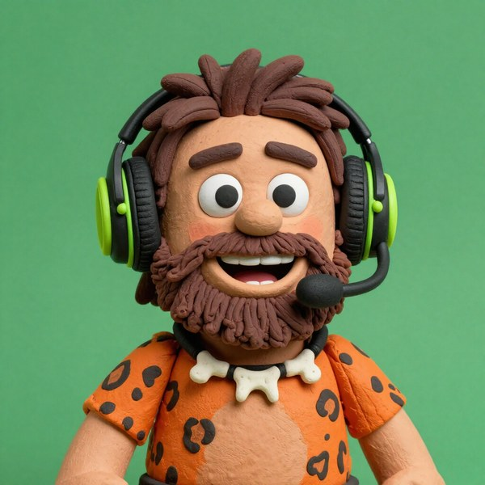
<h3>Claymation <code>claymation</code></h3>

Charming stop-motion clay look, lower contrast.

<a href="assets/nonpixel/cutouts/claymation.png">transparent cutout</a>

Jim&#x27;s pick
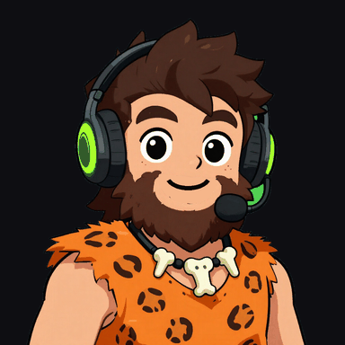
<h3>Anime VTuber <code>anime_vtuber</code></h3>

Anime cel-shade that fits the VTuber look.

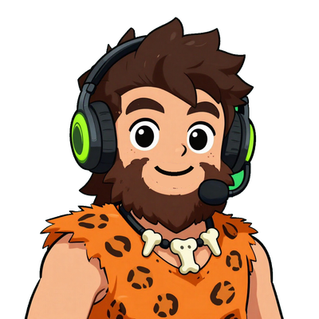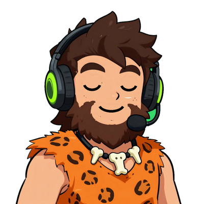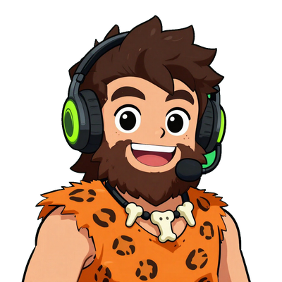

<a href="assets/nonpixel/styles/anime_vtuber.jpg">full image</a> · <a href="assets/nonpixel/cutouts/anime_vtuber.png">transparent cutout</a>

Jim&#x27;s pick
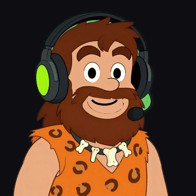
<h3>90s cel cartoon <code>cel_cartoon90s</code></h3>

Cel-shaded 90s cartoon with big eyes, very readable.

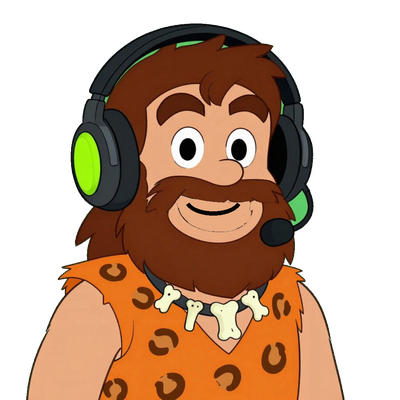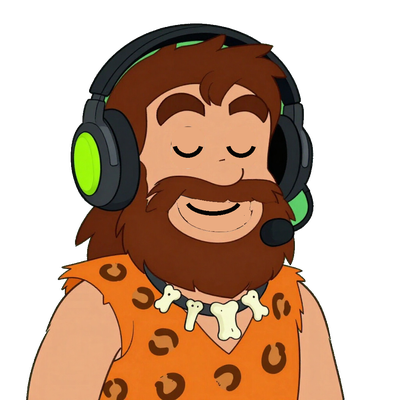

<a href="assets/nonpixel/styles/cel_cartoon90s.jpg">full image</a> · <a href="assets/nonpixel/cutouts/cel_cartoon90s.png">transparent cutout</a>

<h2 id="running">Still in the running</h2>

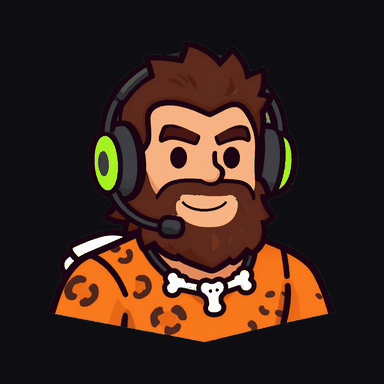
<h3>Vector mascot <code>vector_mascot</code></h3>

Flat vector esports mascot, the clearest at small size (former top pick).

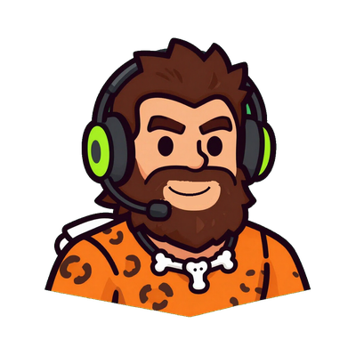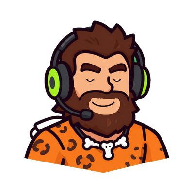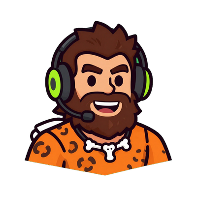

<a href="assets/nonpixel/styles/vector_mascot.jpg">full image</a> · <a href="assets/nonpixel/cutouts/vector_mascot.png">transparent cutout</a>

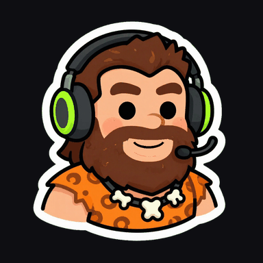
<h3>Die-cut sticker <code>sticker_diecut</code></h3>

Die-cut sticker whose white border stands out on any background; best emote/avatar candidate (former top pick).

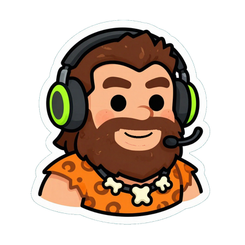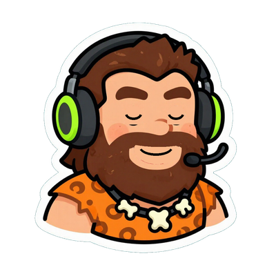

<a href="assets/nonpixel/styles/sticker_diecut.jpg">full image</a> · <a href="assets/nonpixel/cutouts/sticker_diecut.png">transparent cutout</a>

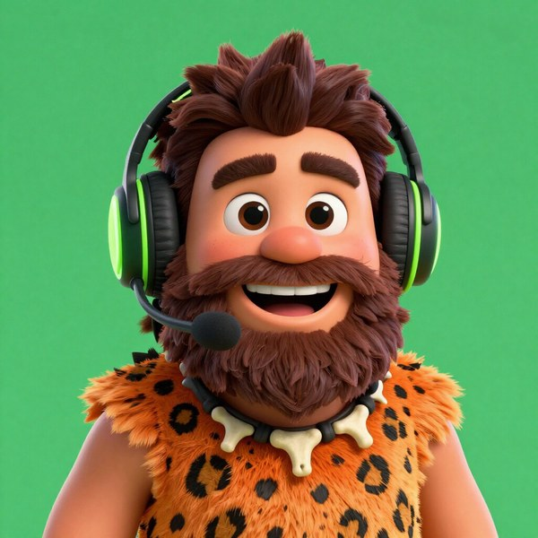
<h3>3D animated film <code>pixar3d</code></h3>

Premium 3D animated-film look, but busy when small.

<a href="assets/nonpixel/cutouts/pixar3d.png">transparent cutout</a>

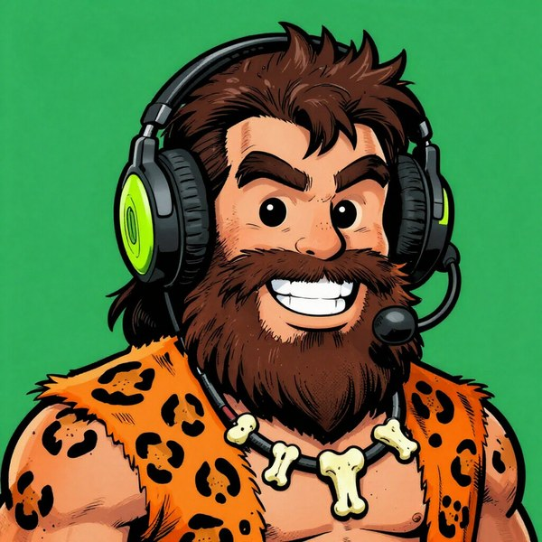
<h3>Comic ink <code>comic_ink</code></h3>

Comic book ink, strong contrast.

<a href="assets/nonpixel/cutouts/comic_ink.png">transparent cutout</a>

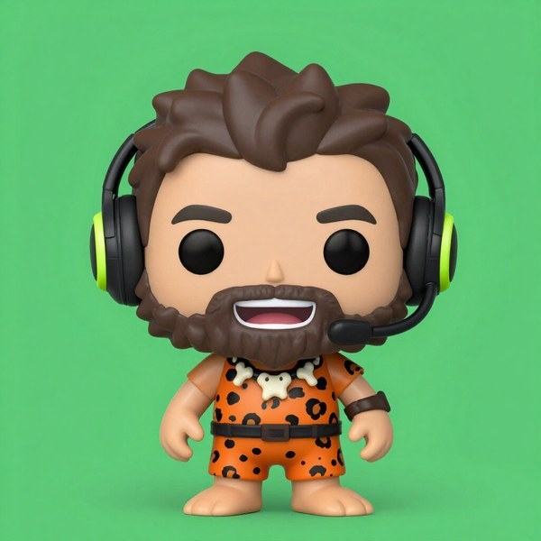
<h3>Vinyl chibi <code>vinyl_chibi</code></h3>

Vinyl toy, cute, but the head is small in the frame.

<a href="assets/nonpixel/cutouts/vinyl_chibi.png">transparent cutout</a>

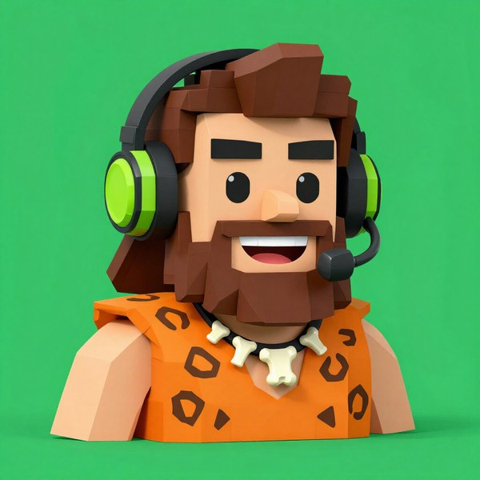
<h3>Low-poly PS1 <code>lowpoly_ps1</code></h3>

Low-poly PS1, nostalgic.

<a href="assets/nonpixel/cutouts/lowpoly_ps1.png">transparent cutout</a>

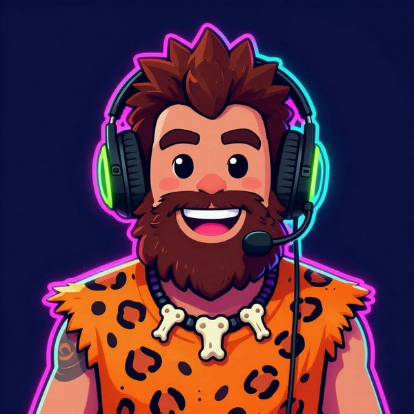
<h3>Synthwave <code>synthwave</code></h3>

Neon; works as an alternate theme.

<a href="assets/nonpixel/cutouts/synthwave.png">transparent cutout</a>

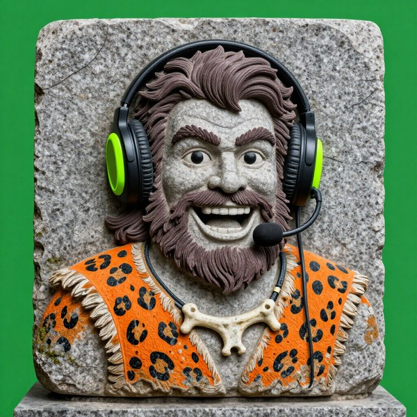
<h3>Stone relief <code>stone_relief</code></h3>

Stone bas-relief with a glowing headset; better as a logo or panel.

<a href="assets/nonpixel/cutouts/stone_relief.png">transparent cutout</a>

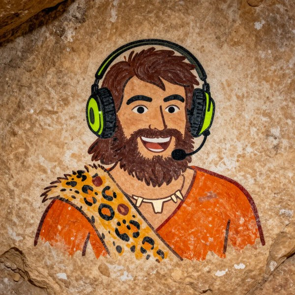
<h3>Cave painting (overlay) <code>cave_painting_OVERLAY</code></h3>

For overlays and alerts only, not the avatar.

Pixel front-runner
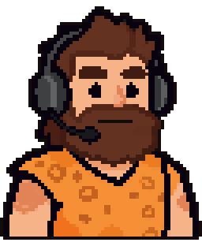
<h3>SNES 64 (headset) <code>snes64_hs</code></h3>

16-bit-style pixel base on a 64 px grid. 64x74 native, x4; headphones yes.

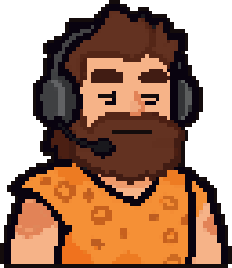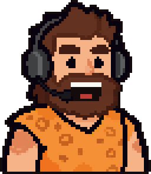

Pixel front-runner
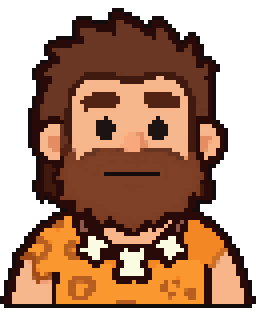
<h3>SNES 64 (no headset) <code>snes64_bare</code></h3>

16-bit-style pixel base on a 64 px grid. 64x75 native, x4; headphones no (bone necklace).

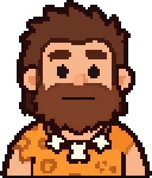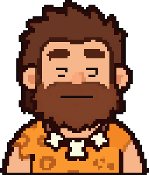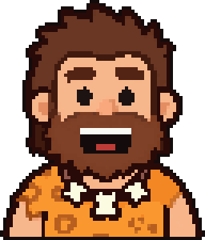

<strong>Earlier rounds</strong> (archived styles, v1 original, overview sheets)

<h3>Archived styles</h3>

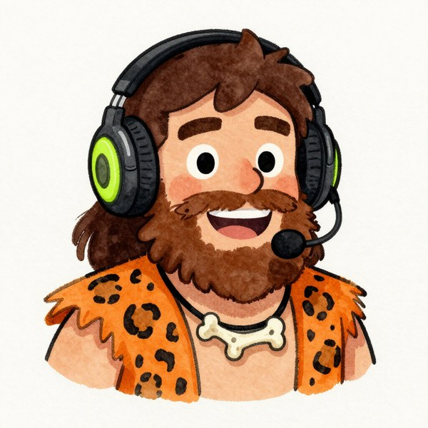
<h3>Watercolor <code>watercolor</code></h3>

Watercolor storybook, weak at stream size.

<a href="assets/nonpixel/cutouts/watercolor.png">transparent cutout</a>

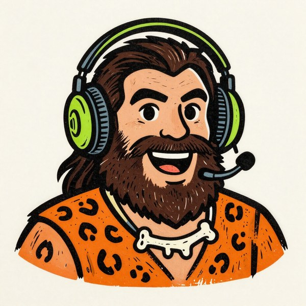
<h3>Woodcut <code>woodcut</code></h3>

Reads more like an ink sketch.

<a href="assets/nonpixel/cutouts/woodcut.png">transparent cutout</a>

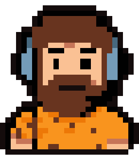
<h3>NES 24 (headset) <code>nes24_hs</code></h3>

Pixel base downsampled locally to a 24 px grid. 26x28 native, x11; headphones yes.

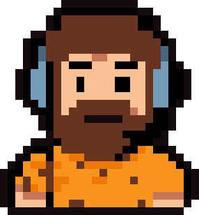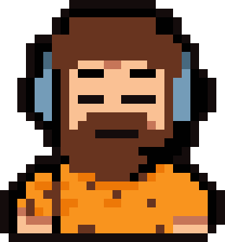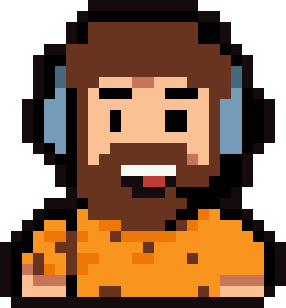

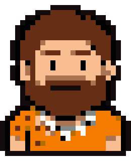
<h3>NES 24 (no headset) <code>nes24_bare</code></h3>

Pixel base downsampled locally to a 24 px grid. 26x30 native, x10; headphones no (bone necklace).

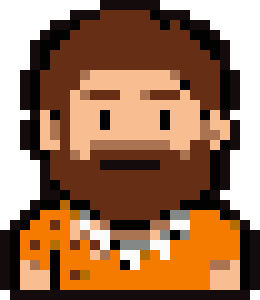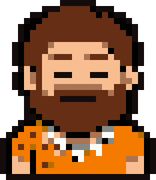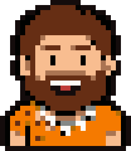

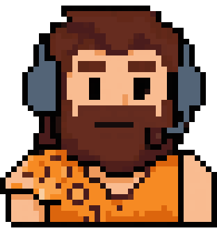
<h3>v1 40 (headset) <code>v1_40_hs</code></h3>

The original v1 sprite with the headset. 39x40 native, x8; headphones yes.

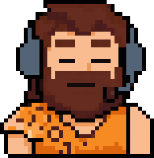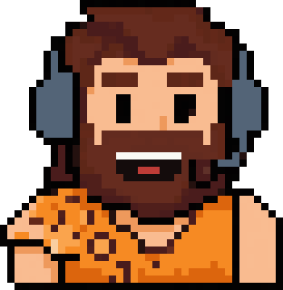

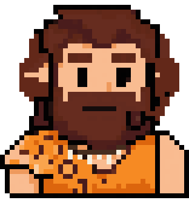
<h3>v1 40 (no headset) <code>v1_40_bare</code></h3>

The original v1 sprite with the headset removed and a bone necklace added. 39x40 native, x8; headphones no (bone necklace).

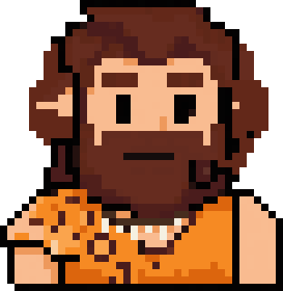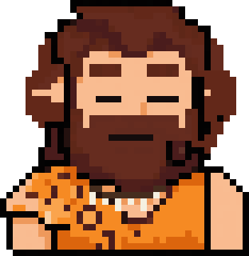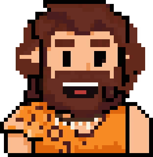

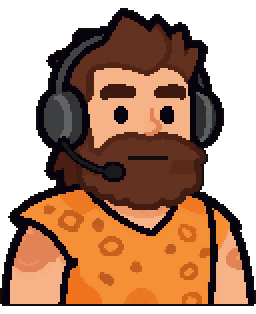
<h3>Hi-bit 128 (headset) <code>hibit128_hs</code></h3>

Detailed hi-bit pixel base on a 128 px grid. 128x149 native, x2; headphones yes.

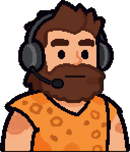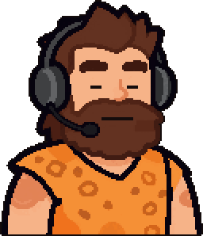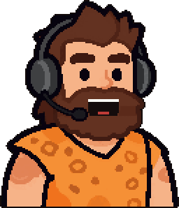

<h3>Hi-bit 128 (no headset) <code>hibit128_bare</code></h3>

Detailed hi-bit pixel base on a 128 px grid. 128x151 native, x2; headphones no (bone necklace).

<h3>Hi-bit (illustration) (no headset) <code>zimg_hibit_bare</code></h3>

Smooth cel illustration, pixelized locally. Bone-and-tooth necklace; the best no-headset look. 71x75 native, x4; headphones no (bone-and-tooth necklace).

<h3>Game Boy (headset) <code>gameboy_hs</code></h3>

The v1 sprite recoloured to the 4-shade Game Boy green palette. Low contrast, so the face gets lost. 39x40 native, x8; headphones yes.

<h3>Arcade (headset) <code>arcade_hs</code></h3>

A CRT arcade look, with a bold black outline and punchier colour. Pops on dark overlays. 68x78 native, x4; headphones yes.

<h3>Black hair 32 (headset) <code>blackhair32_hs</code></h3>

A 32-bit-era take with black hair and a blue headset, on a ~35x43 grid. 35x43 native, x7; headphones yes.

<h3>Controller (headset) <code>controller_hs</code></h3>

The v1 guy holding an NES-style controller. The most &#x27;gamer&#x27; pose, good as an alternate. 40x50 native, x6; headphones yes.

<h3>Chunky (headset) <code>chunky_hs</code></h3>

Chunky cartoon-caveman proportions with a big jaw. Furthest from the approved design. 38x38 native, x8; headphones yes.

<h3>v1 original: 8 PNGtuber states</h3>

312×320 transparent PNGs in <a href="assets/v1/pngtuber/">assets/v1/pngtuber/</a>. idle/idle_blink = silent, talk_open/talk_open_blink = talking, talk_wide = loud, grin/angry/surprised = hotkeys.

<figure><figcaption>idle</figcaption></figure><figure><figcaption>idle_blink</figcaption></figure><figure><figcaption>talk_open</figcaption></figure><figure><figcaption>talk_open_blink</figcaption></figure><figure><figcaption>talk_wide</figcaption></figure><figure><figcaption>grin</figcaption></figure><figure><figcaption>angry</figcaption></figure><figure><figcaption>surprised</figcaption></figure>

Also: <a href="assets/v1/caveman_loop.webm">WebM with alpha</a>, <a href="assets/v1/caveman_loop.png">APNG</a>, <a href="assets/v1/caveman_native_39x40.png">native 39×40</a>.

<h3>Overview sheets</h3>

Pixel round, all 14 animating:

Non-pixel round:

