
⚠️ CONCEPT / PROTOTYPE — not a finished avatar.

# Gamer Caveman

Gamer Caveman is Jim Bohan's retro pixel-art VTuber persona: a caveman gamer built on a native 39×40 pixel grid with a locked 22-colour palette, then scaled up crisply.

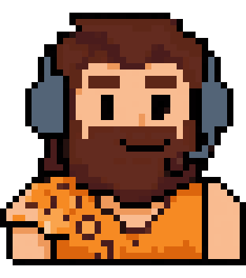

## The PNGtuber approach

Instead of a rigged 3D/Live2D model, a PNGtuber swaps flat images based on your mic: one image when quiet, another when talking, plus blink and expression variants. Free apps:

- **[Veadotube mini](https://olmewe.itch.io/veadotube-mini)** — load an image per state (idle / talking, each with blink), set the mic threshold, add it to OBS as a window or browser source.
- **[PNGTuber Plus](https://kaiakairos.itch.io/pngtuber-plus)** — import the PNGs as sprites, set which show when speaking vs. silent and when blinking, hotkey the expressions.

### Loading the 8 states

| State | File | Use as |
|---|---|---|
| idle | `idle.png` | Silent |
| idle_blink | `idle_blink.png` | Silent + blink |
| talk_open | `talk_open.png` | Talking |
| talk_open_blink | `talk_open_blink.png` | Talking + blink |
| talk_wide | `talk_wide.png` | Loud talking |
| grin | `grin.png` | Expression hotkey |
| angry | `angry.png` | Expression hotkey |
| surprised | `surprised.png` | Expression hotkey |

All are 312×320 transparent PNGs in [`assets/v1/pngtuber/`](assets/v1/pngtuber/).

| idle | idle_blink | talk_open | talk_open_blink |
|---|---|---|---|
|  | 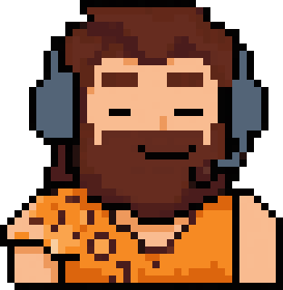 | 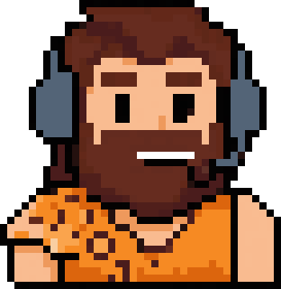 | 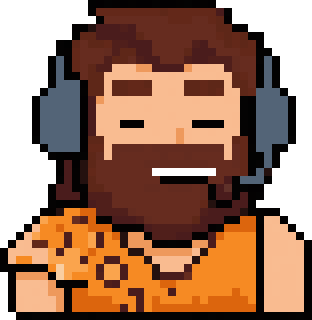 |
| **talk_wide** | **grin** | **angry** | **surprised** |
| 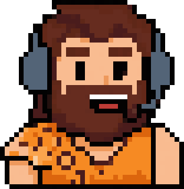 | 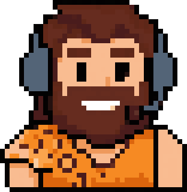 | 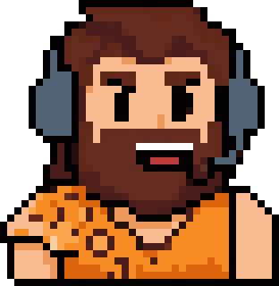 | 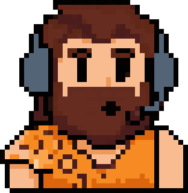 |

## Contact sheet

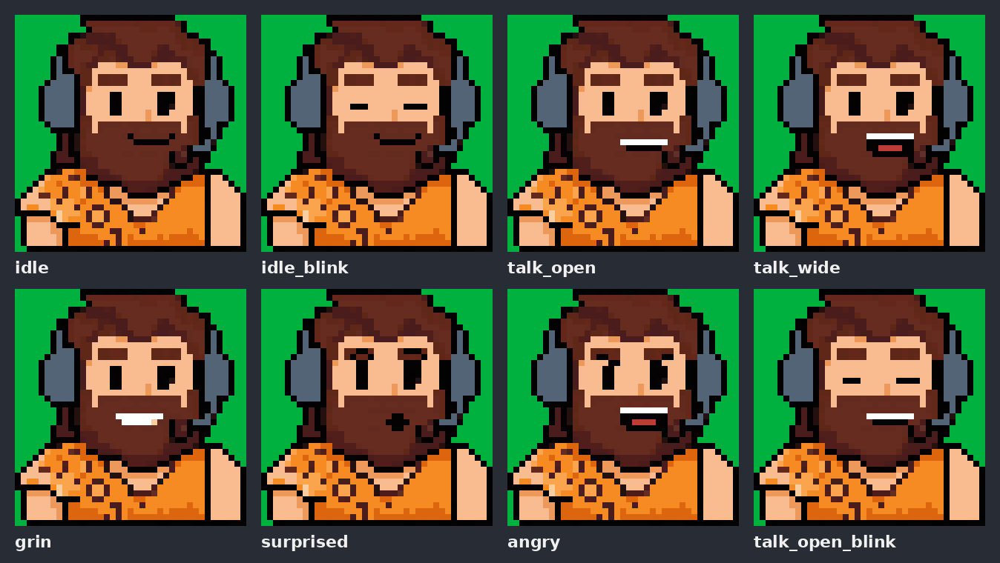

Also available: [WebM with alpha](assets/v1/caveman_loop.webm), [APNG](assets/v1/caveman_loop.png), [native 39×40](assets/v1/caveman_native_39x40.png).

## Style round

14 alternative looks, from NES 24 px to hi-bit 128 px plus wildcards, with and without the headset. SNES 64 is the current front-runner.

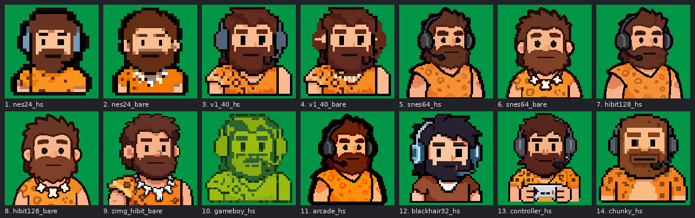

See the **[style showcase](showcase.md)** for every variant with labels and per-state frames.

## Round 2: non-pixel styles

A brainstorm of 14 non-pixel looks (vector mascot, 90s cel cartoon, die-cut sticker, anime and more), with talk/blink PNGtuber loops for the top picks.

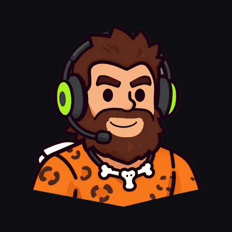

See **[Round 2: non-pixel styles](nonpixel.html)**.
