

⚠️ CONCEPT / PROTOTYPE: non-pixel style brainstorm, nothing final.

<h1>Round 2: non-pixel styles</h1>

<a href="index.html">Home</a> · <a href="showcase.html">Pixel style showcase (round 1)</a>

14 non-pixel takes on Gamer Caveman. Images are scaled down for the web.

<h2>Overview</h2>
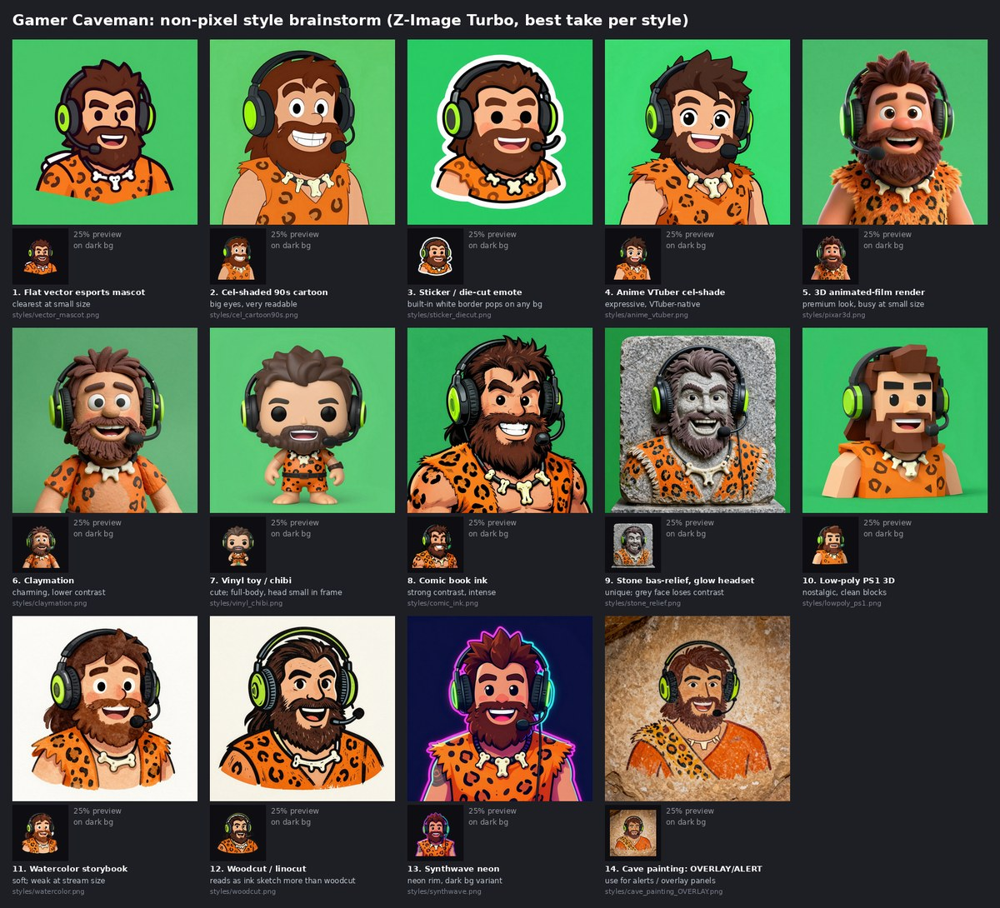
<h2>Top picks</h2>

Talk/blink loops plus idle, blink and talk stills, ready for Veadotube mini or PNGTuber Plus.

Top pick
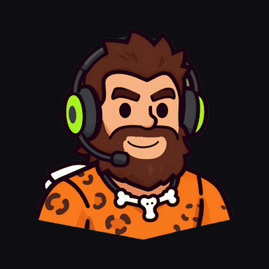
<h3>Vector mascot <code>vector_mascot</code></h3>

Flat vector esports mascot; clearest at small size.

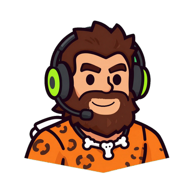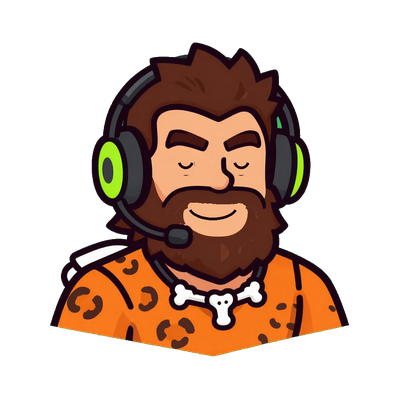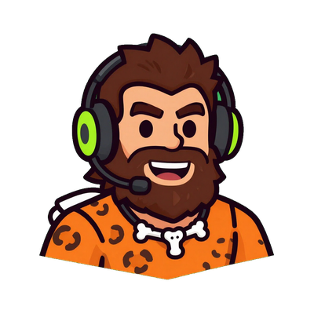

Top pick
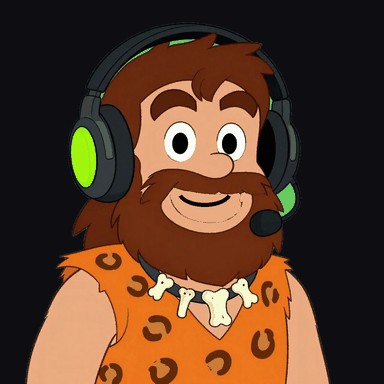
<h3>90s cel cartoon <code>cel_cartoon90s</code></h3>

Cel-shaded 90s cartoon, big eyes; very readable.

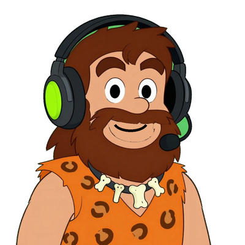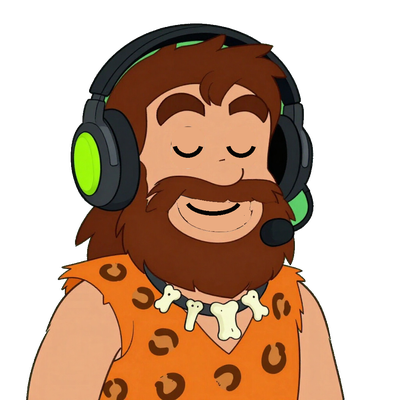

Top pick
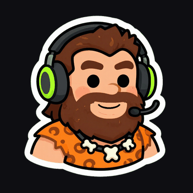
<h3>Die-cut sticker <code>sticker_diecut</code></h3>

Die-cut sticker; white border pops on any background. Best emote/avatar candidate.

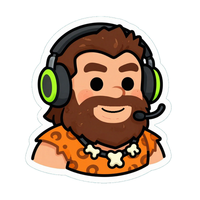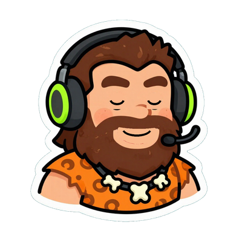

Close behind
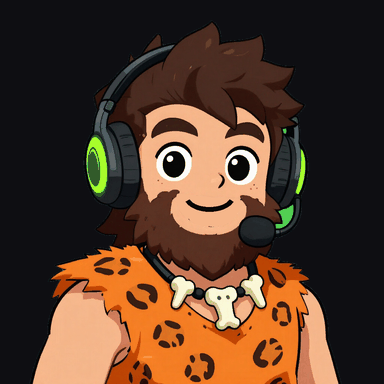
<h3>Anime VTuber <code>anime_vtuber</code></h3>

Anime cel-shade; fits the VTuber look.

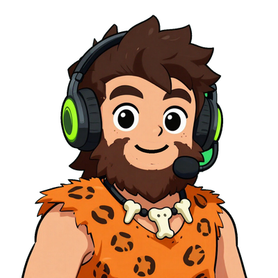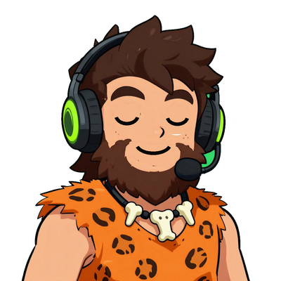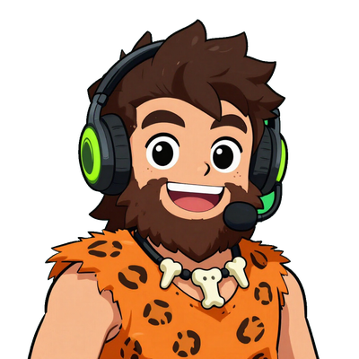

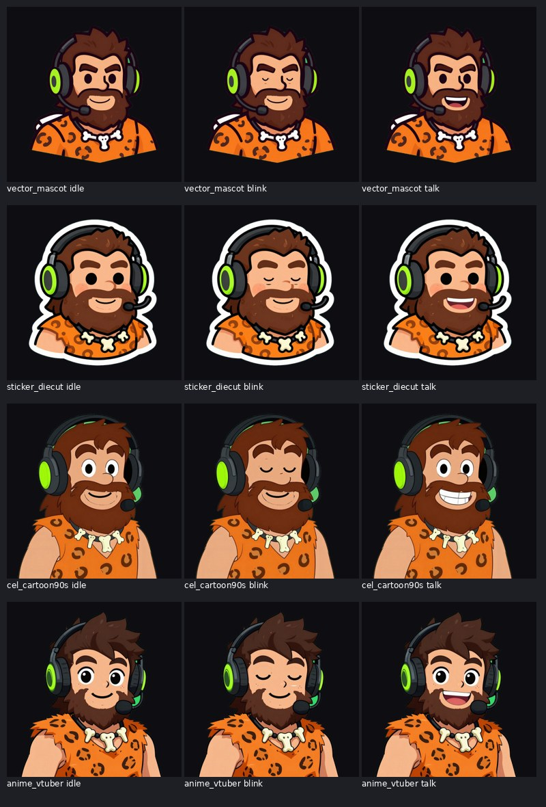
<h2>All 14 styles</h2>

Top pick
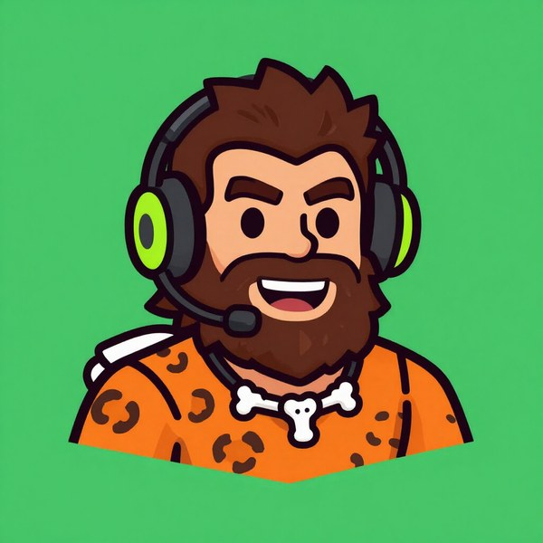
<h3>1. Vector mascot <code>vector_mascot</code></h3>

Flat vector esports mascot; clearest at small size.

<a href="assets/nonpixel/cutouts/vector_mascot.png">Transparent cutout</a>

Top pick
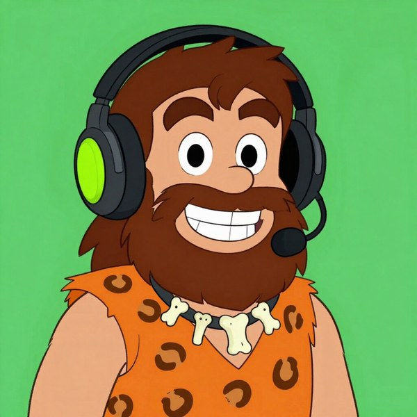
<h3>2. 90s cel cartoon <code>cel_cartoon90s</code></h3>

Cel-shaded 90s cartoon, big eyes; very readable.

<a href="assets/nonpixel/cutouts/cel_cartoon90s.png">Transparent cutout</a>

Top pick
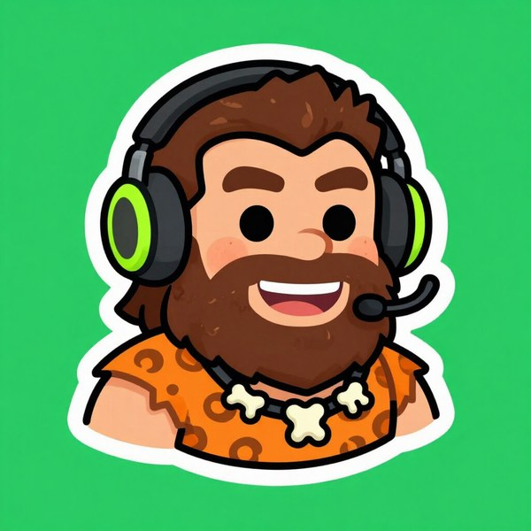
<h3>3. Die-cut sticker <code>sticker_diecut</code></h3>

Die-cut sticker; white border pops on any background. Best emote/avatar candidate.

<a href="assets/nonpixel/cutouts/sticker_diecut.png">Transparent cutout</a>

Close behind
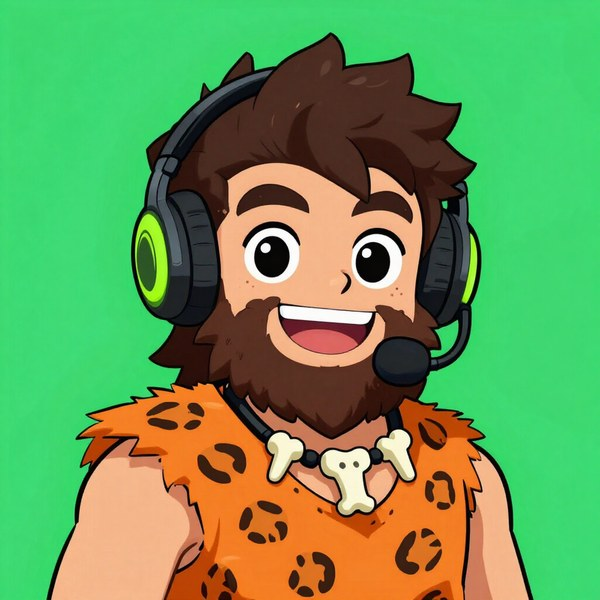
<h3>4. Anime VTuber <code>anime_vtuber</code></h3>

Anime cel-shade; fits the VTuber look.

<a href="assets/nonpixel/cutouts/anime_vtuber.png">Transparent cutout</a>

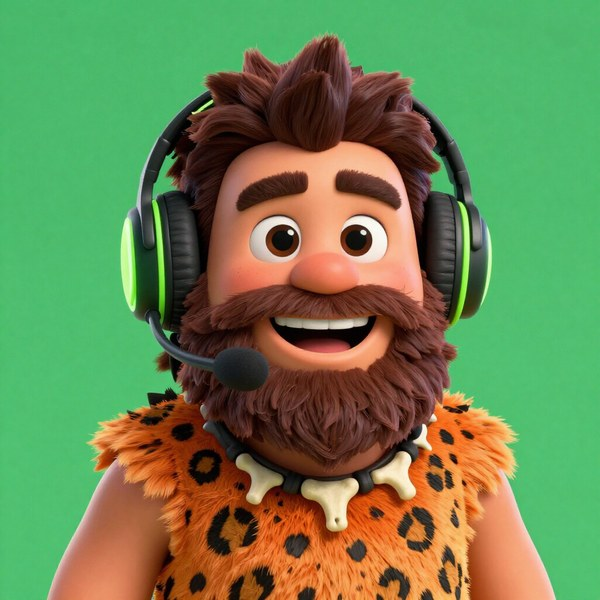
<h3>5. 3D film <code>pixar3d</code></h3>

3D animated-film look; premium but busy when small.

<a href="assets/nonpixel/cutouts/pixar3d.png">Transparent cutout</a>

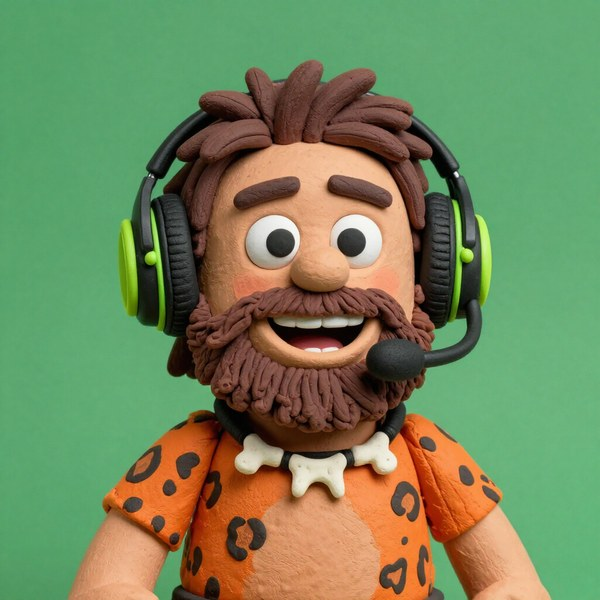
<h3>6. Claymation <code>claymation</code></h3>

Charming, lower contrast.

<a href="assets/nonpixel/cutouts/claymation.png">Transparent cutout</a>

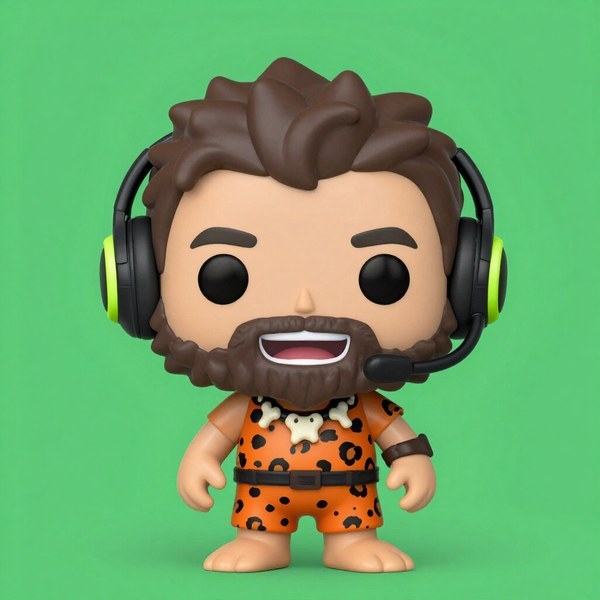
<h3>7. Vinyl chibi <code>vinyl_chibi</code></h3>

Vinyl toy; cute, but the head is small in the frame.

<a href="assets/nonpixel/cutouts/vinyl_chibi.png">Transparent cutout</a>

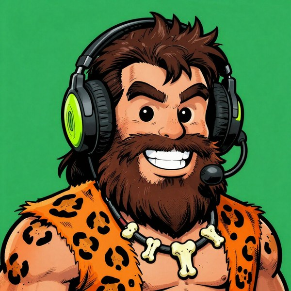
<h3>8. Comic ink <code>comic_ink</code></h3>

Comic-book ink; strong contrast.

<a href="assets/nonpixel/cutouts/comic_ink.png">Transparent cutout</a>

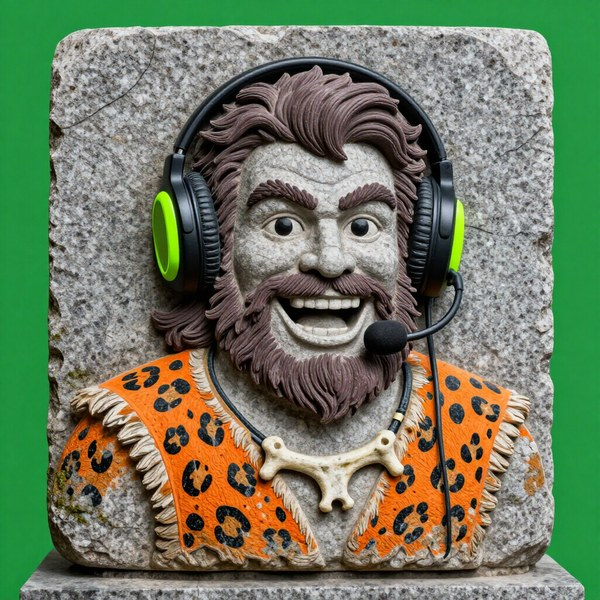
<h3>9. Stone relief <code>stone_relief</code></h3>

Stone bas-relief with glowing headset; better as a logo or panel.

<a href="assets/nonpixel/cutouts/stone_relief.png">Transparent cutout</a>

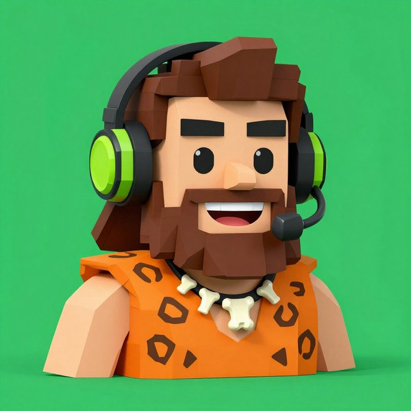
<h3>10. Low-poly PS1 <code>lowpoly_ps1</code></h3>

Low-poly PS1; nostalgic.

<a href="assets/nonpixel/cutouts/lowpoly_ps1.png">Transparent cutout</a>

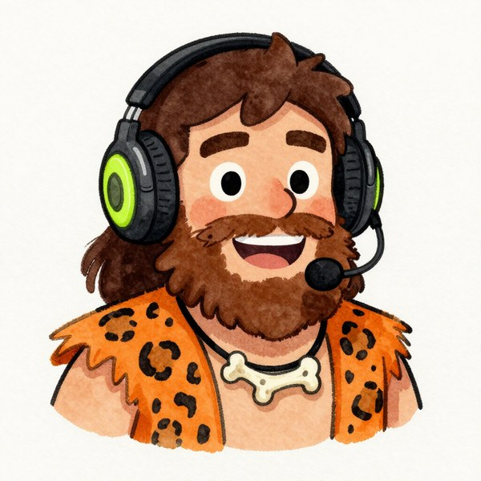
<h3>11. Watercolor <code>watercolor</code></h3>

Watercolor storybook; weak at stream size.

<a href="assets/nonpixel/cutouts/watercolor.png">Transparent cutout</a>

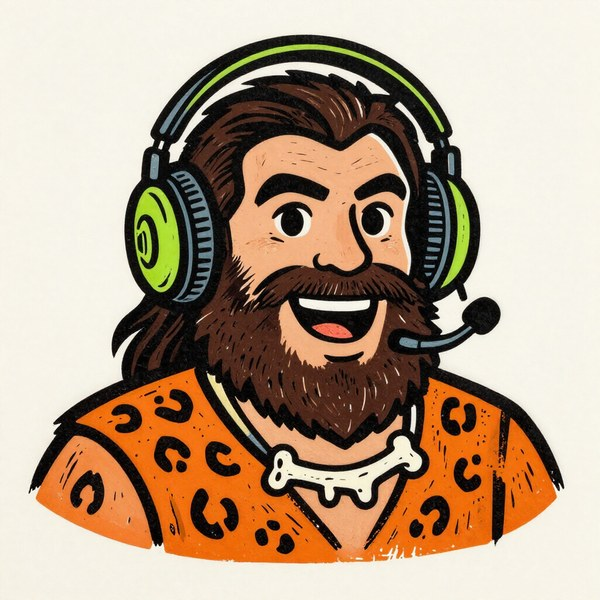
<h3>12. Woodcut <code>woodcut</code></h3>

Reads more like an ink sketch.

<a href="assets/nonpixel/cutouts/woodcut.png">Transparent cutout</a>

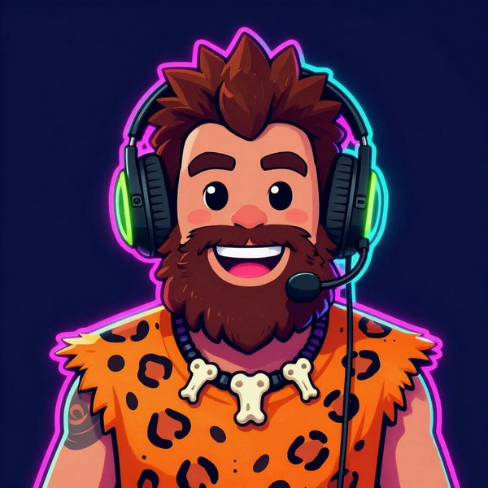
<h3>13. Synthwave <code>synthwave</code></h3>

Neon; works as an alternate theme.

<a href="assets/nonpixel/cutouts/synthwave.png">Transparent cutout</a>

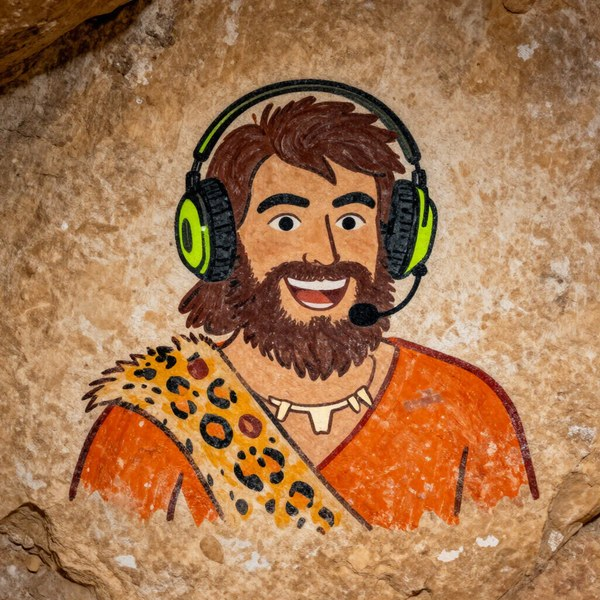
<h3>14. Cave painting (overlay) <code>cave_painting_OVERLAY</code></h3>

For overlays and alerts only, not the avatar.

