
⚠️ CONCEPT / PROTOTYPE: style exploration, nothing final.

Also see [Round 2: non-pixel styles](nonpixel.html).

# Style showcase

[← Back](index.md)

All 14 style variants, animating in sync, then the labelled overview sheet.

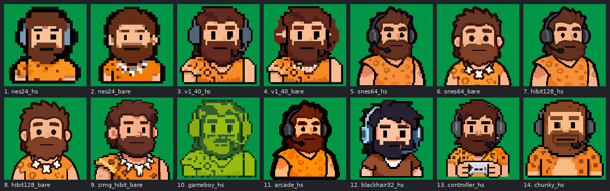

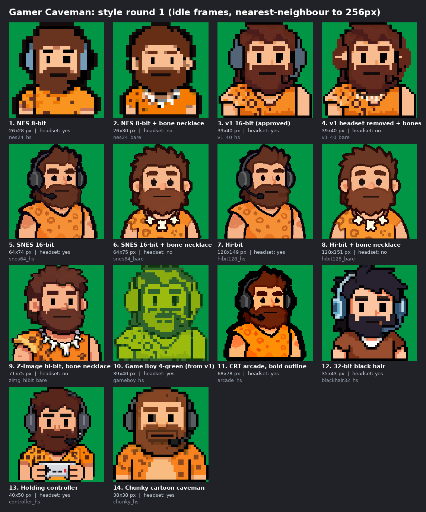

## NES 24

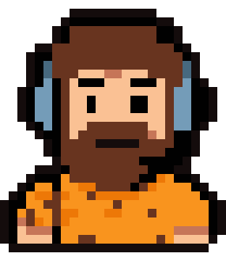
<h3>NES 24 <code>nes24_hs</code></h3>

<b>Resolution:</b> 26x28 native, x11 <b>Headphones:</b> yes

Pixel base downsampled locally to a 24 px grid.

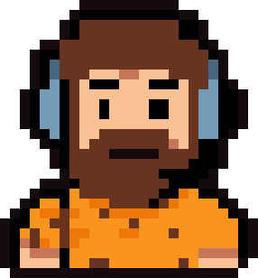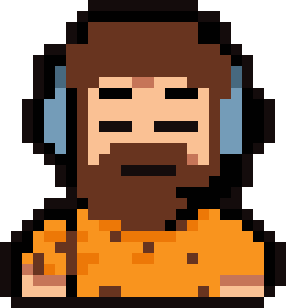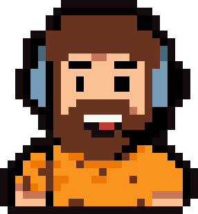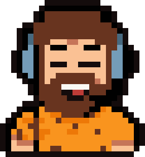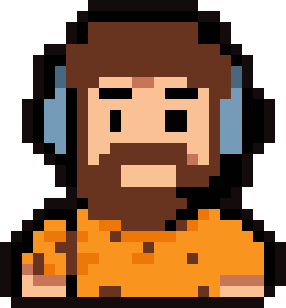

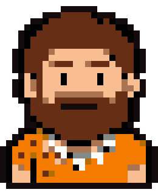
<h3>NES 24 <code>nes24_bare</code></h3>

<b>Resolution:</b> 26x30 native, x10 <b>Headphones:</b> no (bone necklace)

Pixel base downsampled locally to a 24 px grid.

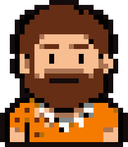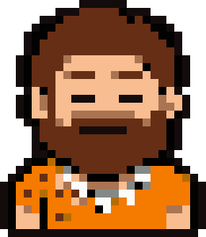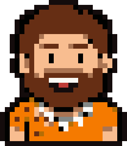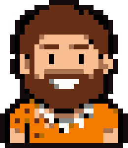

## v1 40

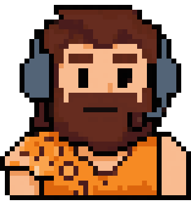
<h3>v1 40 <code>v1_40_hs</code></h3>

<b>Resolution:</b> 39x40 native, x8 <b>Headphones:</b> yes

The original v1 sprite with the headset.

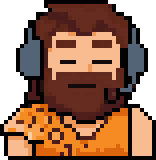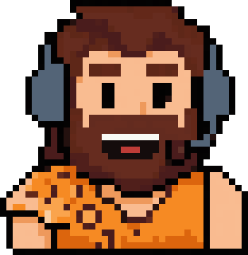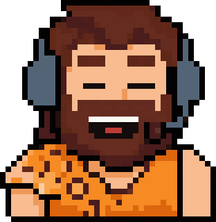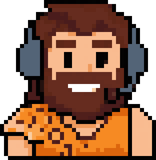

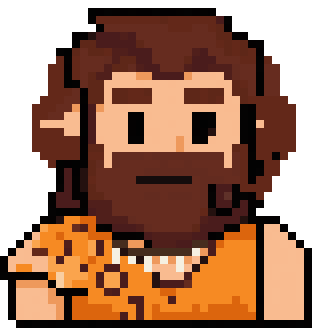
<h3>v1 40 <code>v1_40_bare</code></h3>

<b>Resolution:</b> 39x40 native, x8 <b>Headphones:</b> no (bone necklace)

The original v1 sprite with the headset removed and a bone necklace added.

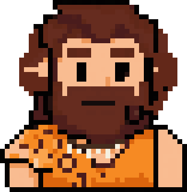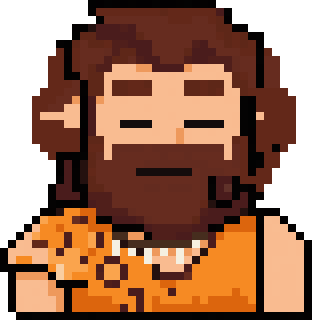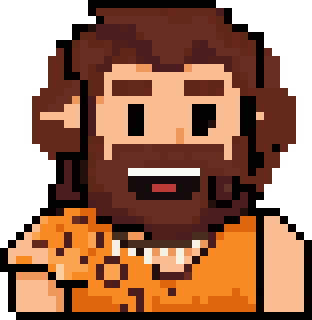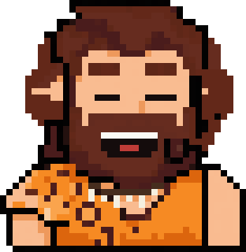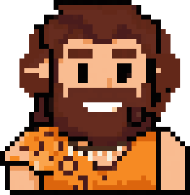

## SNES 64

Front-runner
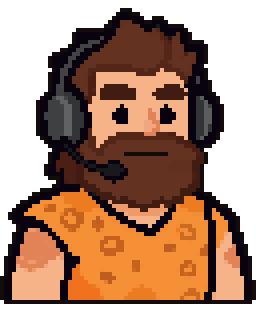
<h3>SNES 64 <code>snes64_hs</code></h3>

<b>Resolution:</b> 64x74 native, x4 <b>Headphones:</b> yes

16-bit-style pixel base on a 64 px grid.

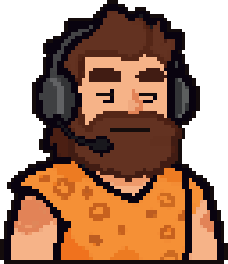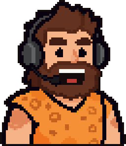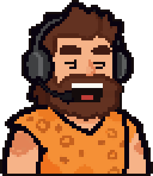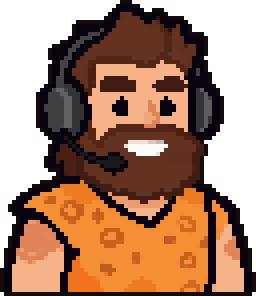

Front-runner
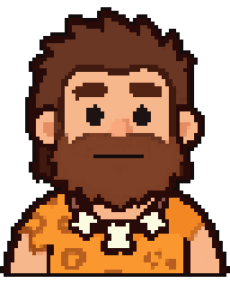
<h3>SNES 64 <code>snes64_bare</code></h3>

<b>Resolution:</b> 64x75 native, x4 <b>Headphones:</b> no (bone necklace)

16-bit-style pixel base on a 64 px grid.

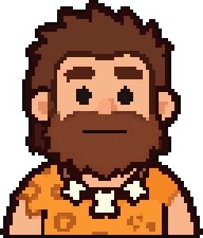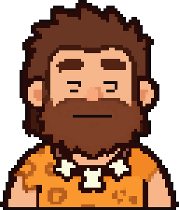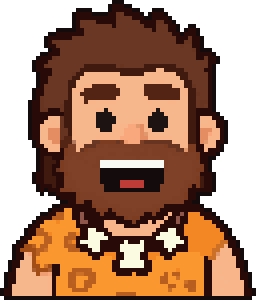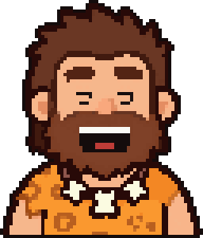

## Hi-bit 128

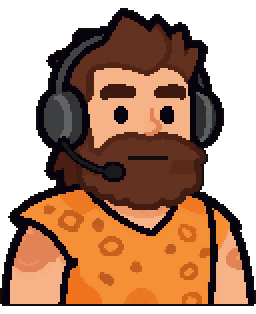
<h3>Hi-bit 128 <code>hibit128_hs</code></h3>

<b>Resolution:</b> 128x149 native, x2 <b>Headphones:</b> yes

Detailed hi-bit pixel base on a 128 px grid.

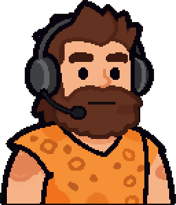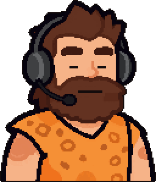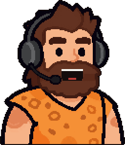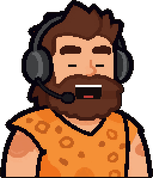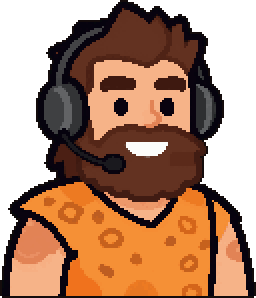

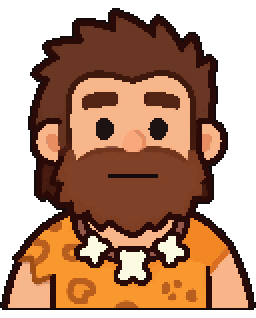
<h3>Hi-bit 128 <code>hibit128_bare</code></h3>

<b>Resolution:</b> 128x151 native, x2 <b>Headphones:</b> no (bone necklace)

Detailed hi-bit pixel base on a 128 px grid.

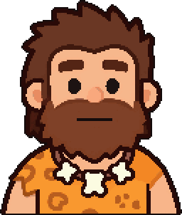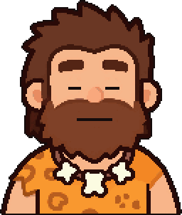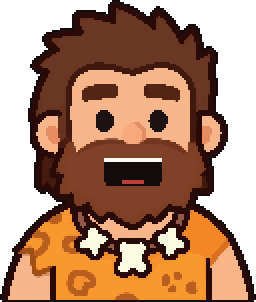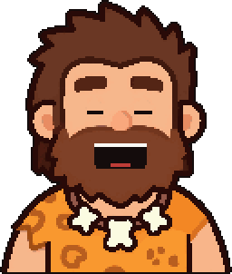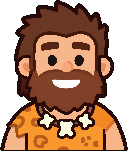

## Wildcard

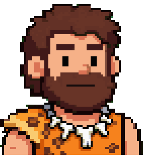
<h3>Hi-bit (illustration) <code>zimg_hibit_bare</code></h3>

<b>Resolution:</b> 71x75 native, x4 <b>Headphones:</b> no (bone-and-tooth necklace)

Smooth cel illustration, pixelized locally. Bone-and-tooth necklace; the best no-headset look.

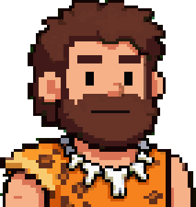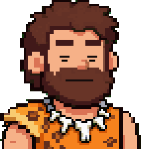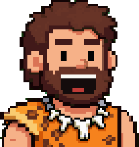

<h3>Game Boy <code>gameboy_hs</code></h3>

<b>Resolution:</b> 39x40 native, x8 <b>Headphones:</b> yes

The v1 sprite recoloured to the 4-shade Game Boy green palette. Low contrast, so the face gets lost.

<h3>Arcade <code>arcade_hs</code></h3>

<b>Resolution:</b> 68x78 native, x4 <b>Headphones:</b> yes

A CRT arcade look, with a bold black outline and punchier colour. Pops on dark overlays.

<h3>Black hair 32 <code>blackhair32_hs</code></h3>

<b>Resolution:</b> 35x43 native, x7 <b>Headphones:</b> yes

A 32-bit-era take with black hair and a blue headset, on a ~35x43 grid.

<h3>Controller <code>controller_hs</code></h3>

<b>Resolution:</b> 40x50 native, x6 <b>Headphones:</b> yes

The v1 guy holding an NES-style controller. The most 'gamer' pose, good as an alternate.

<h3>Chunky <code>chunky_hs</code></h3>

<b>Resolution:</b> 38x38 native, x8 <b>Headphones:</b> yes

Chunky cartoon-caveman proportions with a big jaw. Furthest from the approved design.

## v1 original

<h3>v1 (original) <code>v1</code></h3>

<b>Resolution:</b> 39x40 native, x8 <b>Headphones:</b> yes

The first full set; its 8 PNGtuber states are on the home page.

Per-state frames shown: idle, blink, talk, talk_blink, grin.
